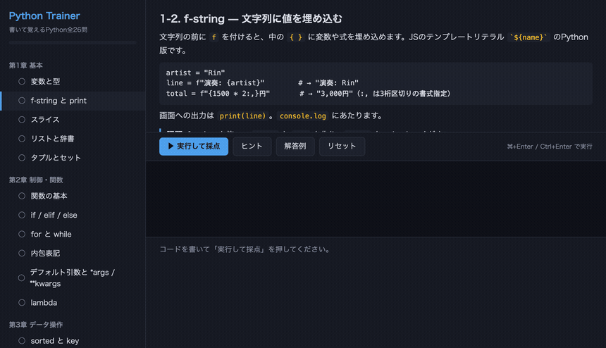

# Python Trainer — 書いて覚えるPython

読むだけでは書けるようにならないので、**書いて、即採点して、次へ**進むだけのドリル。
全26問、値・出力・書き方の3方向から採点します。



**▶ その場で試す: https://npulsar-droid.github.io/py-trainer/**

インストール不要。ブラウザの中で本物のPython（[Pyodide](https://pyodide.org/)）が動いて採点します。

## 2つの動かし方

同じ問題・同じ採点ロジックを、2通りの実行環境で動かせます。

| | ブラウザ版 | ローカル版 |
|---|---|---|
| 起動 | URLを開くだけ | `python3 py_trainer.py` |
| Pythonの実体 | Pyodide（WebAssembly） | あなたのマシンのCPython |
| 進捗の保存先 | localStorage | `state.json`（書きかけのコードごと） |
| 初回の待ち時間 | Python本体の取得で数秒 | なし |

**採点ロジック（`runner.py`）と問題（`chapters/`）は両者で共有**しています。
ブラウザ版はこの `runner.py` をそのまま Pyodide に読み込ませているので、判定がズレません。
全26問の解答例が両方の環境で同じ結果になることを確認しています。

## カリキュラム（全26問）

| 章 | 内容 |
|---|---|
| 第1章 基本 | 変数・型 / f-string / スライス / リスト・辞書 / タプル・セット |
| 第2章 制御・関数 | def / if / for・while / 内包表記 / デフォルト・\*args・\*\*kwargs / lambda |
| 第3章 データ操作 | sorted・key / zip・enumerate / map・filter / 辞書操作 / ファイルI/O |
| 第4章 Pythonらしさ | クラス / dataclass / try・except / with文 / import |
| 第5章 実践 | collections / itertools / pathlib / json / 卒業課題（集計レポートスクリプト） |

各章に「📚 深めるなら」として、公式チュートリアル（docs.python.org 日本語版）と
Automate the Boring Stuff（無料公開版）の対応章へのリンクが付いています。

ファイルを読み書きする問題もあります。どちらの環境でも、採点のたびに作られる
**使い捨ての作業フォルダ**の中で実行されるので、他のファイルを触りません
（ブラウザ版はそもそも仮想ファイルシステムの中です）。

## 採点の中身

- **値** — `bpm` は整数の128か、など。型名まで確認します
- **出力** — `print` した内容が期待どおりか
- **書き方** — 「f-string を使っている」「内包表記で書いている」など、正規表現でソースを確認

間違えると「期待値 128 / 実際 999」のように**どこがどう違うか**が出ます。
例外も `1行目: NameError: name 'x' is not defined（名前のタイプミス、または定義し忘れかもしれません）`
のように、行番号と補足つきで表示されます。

一度でも間違えた問題は、クリア後も「3問クリアするごと」に🔁マークで再出題されます。

## 無限ループを書いてしまっても大丈夫

どちらの環境も**5秒で打ち切ります**。ブラウザ版は採点を Web Worker に閉じ込めてあり、
時間切れになったら worker ごと破棄して作り直すので、タブが固まりません。

## ローカル版を動かす

```bash
python3 py_trainer.py
```

サーバーが起動してブラウザが開きます。終わるときは `Ctrl+C`。

```bash
python3 py_trainer.py --no-browser   # サーバーだけ起動（http://localhost:8346/）
```

> **注意**: このサーバーは、送られてきたPythonコードをそのまま実行します。
> 自分のマシンで自分のコードを動かすためのものなので `127.0.0.1` だけを見ていますが、
> **公開サーバーにデプロイしないでください**（誰でも任意のコードを実行できる口になります）。
> インターネットに置きたい場合は、ブラウザ版（`index.html`）を静的ホスティングしてください。

## ブラウザ版をビルドする

`index.html` は生成物です。問題や採点ロジックを変えたら、作り直してください。

```bash
python3 build.py
```

`template.html` + `chapters/` + `runner.py` から単一の `index.html` を書き出します。

## テスト

```bash
python3 -m pytest test_py_trainer.py -q     # 88 passed
```

全問の解答例が採点を通ることを検証します（pytest が必要です）。

## ファイル

| ファイル | 役割 |
|---|---|
| `index.html` | ブラウザ版（生成物）。これ1つで動きます |
| `build.py` | `index.html` を生成する |
| `py_trainer.py` | ローカル版のサーバー。標準ライブラリのみ |
| `runner.py` | 採点ハーネス。両方の環境で共有している中身 |
| `chapters/ch1.py` … `ch5.py` | カリキュラム。1章1ファイル |
| `template.html` | 画面。ブラウザ版とローカル版で共通 |
| `test_py_trainer.py` | テスト |

## 問題を増やすには

`chapters/chN.py` の `lessons` に辞書を1つ足すだけです。形式は
`chapters/__init__.py` の docstring にあります。足したら pytest を回して、
解答例がチェックを通ることを確認し、`python3 build.py` でブラウザ版に反映してください。

## ライセンス

MIT
